<a href="https://github.com/shanmukha-belide-pixel/shanmukha-belide-pixel">
  <picture>
    <source media="(prefers-color-scheme: dark)" srcset="https://raw.githubusercontent.com/shanmukha-belide-pixel/shanmukha-belide-pixel/main/dark.svg">
    <source media="(prefers-color-scheme: light)" srcset="https://raw.githubusercontent.com/shanmukha-belide-pixel/shanmukha-belide-pixel/main/light.svg">
    
  </picture>
</a>
 

  

